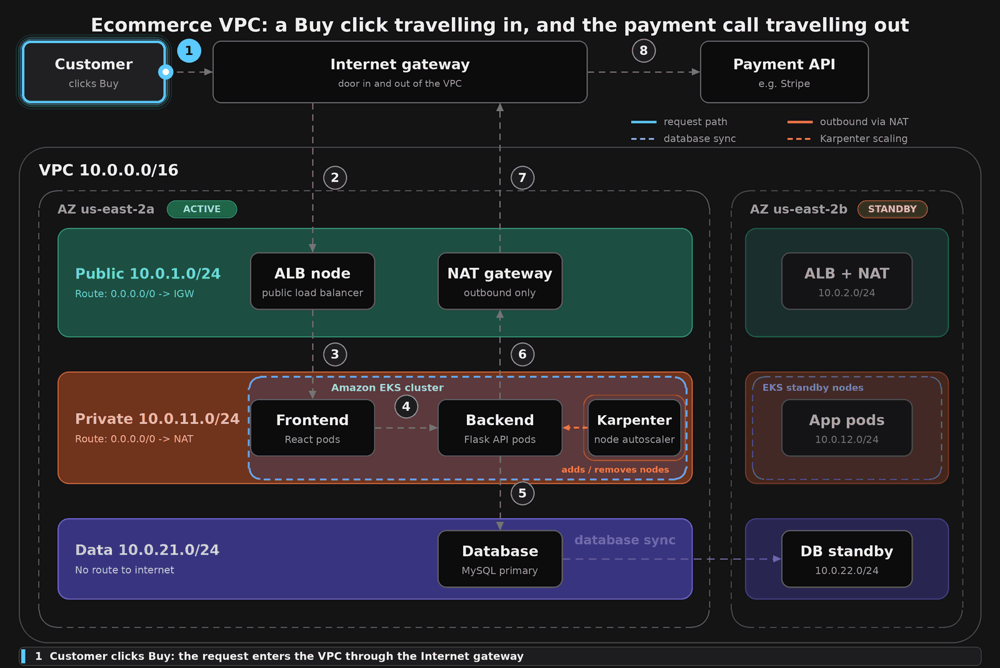

# AnimeThreads Infrastructure

Terraform for the AnimeThreads platform on AWS: a multi-AZ VPC, an EKS cluster autoscaled by Karpenter, a Multi-AZ PostgreSQL database, and ArgoCD for GitOps deployments.



*A customer's Buy click travels in through the Internet gateway, ALB, frontend, backend and database. The payment call travels out through the NAT gateway and Internet gateway. The diagram is simplified, so see the tables below for the exact subnets.*

## What it creates

| File | Resources |
|------|-----------|
| `vpc.tf` | VPC `10.0.0.0/16`, Internet gateway, 2 AZs with public, private and DB subnets, one NAT gateway per AZ, route tables |
| `eks.tf` | EKS cluster (Kubernetes 1.34) with one small system node per AZ, Pod Identity, API endpoint restricted to your IP |
| `karpenter.tf` | Karpenter (Helm chart 1.12.0), EC2NodeClass and NodePool for application nodes |
| `addons.tf` | AWS Load Balancer Controller, metrics-server, gp3 StorageClass |
| `rds.tf` | PostgreSQL 16 on RDS, Multi-AZ, encrypted, private subnets only |
| `argocd.tf` / `apps.tf` | ArgoCD, the `animethreads` and monitoring Applications, namespace and secrets |

## Network layout

| Tier | AZ a | AZ b | Route to internet |
|------|------|------|-------------------|
| Public (ALB, NAT) | `10.0.0.0/24` | `10.0.1.0/24` | `0.0.0.0/0` -> Internet gateway |
| Private (EKS nodes and pods) | `10.0.16.0/20` | `10.0.32.0/20` | `0.0.0.0/0` -> NAT gateway in the same AZ |
| Data (RDS) | `10.0.100.0/24` | `10.0.101.0/24` | None (local route only) |

- Inbound: Customer -> Internet gateway -> ALB -> frontend -> backend -> database.
- Outbound (for example, a payment API call): backend -> NAT gateway -> Internet gateway.
- RDS only accepts PostgreSQL (5432) from the private subnets. The standby database in the second AZ is kept in sync by RDS.

## Usage

```bash
terraform init
terraform plan  -var region=<aws-region> -var my_ip_cidr=<your.ip>/32
terraform apply -var region=<aws-region> -var my_ip_cidr=<your.ip>/32

# connect to the cluster
aws eks update-kubeconfig --region <aws-region> --name animethreads-eks
```

`bootstrap_apps` is `false` by default. Set it to `true` after the ArgoCD manifests are pushed to the app repo.

## Requirements

Terraform >= 1.6, AWS provider >= 6.0, and AWS credentials with permission to create VPC, EKS, IAM and RDS resources.

> Practice setup. RDS has `skip_final_snapshot = true`, `deletion_protection = false` and SSL not enforced. Harden these before using it for production.
